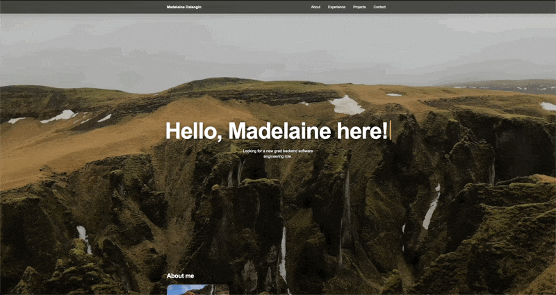

# madelainedalangin.com

Source code for my personal website, hosted on GitHub Pages at [madelainedalangin.com](https://madelainedalangin.com).



It is a single page with four sections: About, Experience, Projects and Contact.

## Built with

- HTML
- CSS
- One small JavaScript file

There are no frameworks, packages or build steps. The files in this repository are the website.

## Features

- Typing animation on the landing screen
- Background photo that blurs gradually as you scroll down and sharpens as you scroll back up
- Sections and cards that fade up once as they scroll into view
- Project cards with expandable details and links to each project's code
- Works without JavaScript and with Reduce Motion turned on: all content stays visible and the animations are skipped

## Project structure

```
Madelaine-v1/
├── CNAME           custom domain for GitHub Pages
├── index.html      all page content
├── favicon.svg     browser tab icon
├── files/
│   └── MadelaineDalangin.pdf   my resume, linked from Contact
├── css/
│   └── style.css   all styles, with a table of contents at the top
├── js/
│   └── reveal.js   fade-up reveals and the scroll-linked photo blur
└── images/         photos, project images, icons and the README preview GIF
```

## Run it locally

Open `index.html` in a browser.

To match GitHub Pages more closely, serve the folder instead:

```
python3 -m http.server 8000
```

Then go to http://localhost:8000.

## Making changes

- **Colors:** edit the design tokens in section 1 of `css/style.css`.
- **Photo blur and dimming:** change `--backdrop-blur`, `--backdrop-brightness` and `--photo-brightness-scrolled` in the same section.
- **Projects:** copy an existing `<article class="panel card reveal">` block in `index.html` and update its text, tags and link.

File names are case-sensitive on GitHub Pages, so image paths in the code must match the file names exactly.

## Deployment

GitHub Pages publishes the `main` branch from the repository root. The `CNAME` file points the site to the custom domain.

## License

The code is available under the terms in [LICENSE](LICENSE). Photos, GIFs and written content are my own and are not covered by the license.